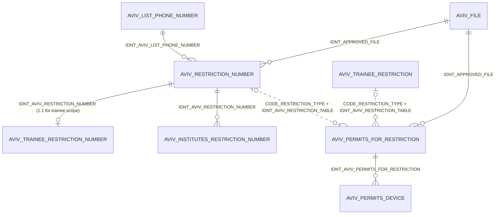

# Number restrictions and permits – server side, phase 1: business analysis of the schema

Status: approved on 2026-11-05 (two review rounds with the product owner); sections 4–7 were updated on 2026-11-07 with the phase-2 decisions (A-n). Decisions and open items are tracked in [decisions.md](decisions.md); the architecture is in [02-architecture.md](02-architecture.md).

Scope of this document: feature 04, "הגבלות והיתרים למספר" (number restrictions and permits for one trainee). It checks the DBA's tables against the product specs (00, 03, 04) and the client contract (`src/types/*.schema.ts`), records what was decided, and lists the schema changes to request from the DBA. It does not design controllers or procedures; that is phase 2.

---

## 1. Inputs and sources

| Source | What it gave |
|---|---|
| `AVIV.xlsx`, `TABLE_NAMES.txt`, `COLUMNS.txt` | The 7 tables, their non-generic columns, and the DBA's notes on parent/child relations |
| Generic columns (excluded from the export, present on every table) | `DATE_CREATED`, `DATE_UPDATED`, `LOGI_ACTIVE`, `IDNT_USER_UPDATE`, `LAST_REQUEST_UID`, `LAST_SUCCESS_REQUEST_UID`, `IDNT_CANCELLED_FILE` |
| Added by the owner in review | `AVIV_FILE` (approval files), `DECODE` (code sets, one `CODE_TABLE` per set), the trainees table lives in another database |
| Specs | `00_foundations.md` (§5 formats, §6 lookups, §7 API conventions), `01_children_list.md` (trainee flags), `03_trainee_restriction_overview.md`, `04_number_restriction_*.md` |
| Client contract | `common.schema.ts`, `phone-exceptions.schema.ts`, `trainee-restrictions.schema.ts`, `trainees.schema.ts`, `organization.schema.ts` |
| Mock server (the "server" the client was built against) | `src/mock-server/handlers/phoneExceptionsHandlers.ts`, `recordInputValidation.ts`, `traineesHandlers.ts` |
| Independent DBA review | A separate review pass over the same inputs; its findings were merged here |

---

## 2. Tables and relations

| Table | Role | Non-generic columns |
|---|---|---|
| `AVIV_LIST_PHONE_NUMBER` | Dictionary of known phone numbers | `IDNT_AVIV_LIST_PHONE_NUMBER` (PK), `PHONE_NUMBER_UID` (Cellcom's identifier, not ours), `TEXT_PHONE_NUMBER`, `CODE_SOURCE_RECORD_TYPE` (not used) |
| `AVIV_RESTRICTION_NUMBER` | A restriction on a number, general or per trainee – **the parent** | `IDNT_AVIV_RESTRICTION_NUMBER` (PK), `IDNT_AVIV_LIST_PHONE_NUMBER`, `DATE_RESTRICTION_START/END`, `TEXT_RESTRICTION_REASON` (= free-text details), `IDNT_APPROVED_FILE`, `IDNT_USER_APPROVAL`; **new:** `CODE_RESTRICTION_SCOPE` |
| `AVIV_TRAINEE_RESTRICTION_NUMBER` | Links a number restriction to one trainee (1:1 with the parent for trainee scope) | `IDNT_AVIV_TRAINEE_RESTRICTION_NUMBER` (PK), `IDNT_AVIV_RESTRICTION_NUMBER`, `IDNT_TRAINEE`, approval columns (left NULL) |
| `AVIV_INSTITUTES_RESTRICTION_NUMBER` | Narrows a general restriction to specific institutes | `IDNT_AVIV_INSTITUTES_RESTRICTION_NUMBER` (PK), `IDNT_AVIV_RESTRICTION_NUMBER`, `IDNT_INSTITUTE`, approval columns (left NULL) |
| `AVIV_TRAINEE_RESTRICTION` | Restriction of all calls of a trainee, no number (feature 03, out of scope) | `IDNT_AVIV_TRAINEE_RESTRICTION` (PK), `IDNT_AVIV_TRAINEE_DATA` (to become `IDNT_TRAINEE`), `RESTRICTION_UID`, `CODE_RESTRICTION` (not used), `DATE_RESTRICTION_START/END`, `NUMB_DURATION_LIMIT`, approval columns |
| `AVIV_PERMITS_FOR_RESTRICTION` | Three uses: a permit the user creates on a number restriction; the trainee's own conditions of a number restriction (inline permit); the "permits inside" a trainee restriction (03) | `IDNT_AVIV_PERMITS_FOR_RESTRICTION` (PK), `IDNT_AVIV_RESTRICTION_TABLE` + `CODE_RESTRICTION_TYPE` (polymorphic parent), `IDNT_TRAINEE`, `IDNT_INSTITUTE`, `IDNT_LOCATION`, `DATE_PERMIT_START/END`, `TIME_PERMIT_START/END`, `NUMB_DURATION_LIMIT`, approval columns; **new:** `LOGI_RESTRICTION_INLINE_PERMIT`, `TEXT_PERMIT_REASON` |
| `AVIV_PERMITS_DEVICE` | Devices of a permit row | `IDNT_AVIV_PERMITS_DEVICE` (PK), `IDNT_AVIV_PERMITS_FOR_RESTRICTION`, `IDNT_DEVICE`, approval columns (left NULL) |
| `AVIV_FILE` | Approval file details (the file itself is in SharePoint) | `IDNT_AVIV_FILE` (PK), `TEXT_FILE` (SharePoint path) |
| `DECODE` | Code sets | `CODE_TABLE` per set; new sets `AVIV_RESTRICTION_TYPE`, `AVIV_RESTRICTION_SCOPE` |

### 2.1 Entity-relationship diagram

Solid line = regular foreign key. Dotted line = polymorphic reference: `CODE_RESTRICTION_TYPE` says which table `IDNT_AVIV_RESTRICTION_TABLE` points to.

### 2.2 How one client record spreads over the tables

| Client record (spec 04) | Rows |
|---|---|
| **Number restriction of a trainee** (`TraineePhoneRestrictionRecordDto`) | `AVIV_LIST_PHONE_NUMBER` (the number) ← `AVIV_RESTRICTION_NUMBER` (scope = trainee; dates, details, approval) ← `AVIV_TRAINEE_RESTRICTION_NUMBER` (the trainee; this row's id is the client's `id`) + when the restriction has conditions: one `AVIV_PERMITS_FOR_RESTRICTION` row with `LOGI_RESTRICTION_INLINE_PERMIT = 1` (duration / hours; the client's `inlinePermitId`) + its `AVIV_PERMITS_DEVICE` rows |
| **Number permit** (`TraineePhonePermitRecordDto`) | `AVIV_PERMITS_FOR_RESTRICTION` with `LOGI_RESTRICTION_INLINE_PERMIT = 0` (dates, hours, duration, details, approval, `IDNT_TRAINEE`) + `AVIV_PERMITS_DEVICE`, pointing to the source restriction in `AVIV_RESTRICTION_NUMBER` (+ `AVIV_INSTITUTES_RESTRICTION_NUMBER` for institute names) |
| **General restriction** (future national client) | `AVIV_RESTRICTION_NUMBER` (scope = general) + optionally one `AVIV_INSTITUTES_RESTRICTION_NUMBER` row per institute |
| **Trainee restriction** (feature 03, out of scope) | `AVIV_TRAINEE_RESTRICTION` + inline permit row (flag = 1) + `AVIV_PERMITS_DEVICE` |

---

## 3. What the client assumes, and how the mock behaves

- Restriction record: `id` = the trainee link row, `restrictionNumberId` = the parent, `inlinePermitId` = the conditions row. Permit record: `id` = the permit row, `sourceRestriction` = a summary of the parent with a three-valued `scope` (national / institute / trainee) and `existingTraineePermits`.
- Permit lookup: `traineeId`, `instituteId`, `phoneNumbers[]` → every not-ended restriction (future ones included) that applies to the trainee, sorted national → institute → trainee → start date.
- Update: `previousId` / `previousPermitId`; 404 when unknown, 409 when already replaced or ended. Create permit: 409 when the restriction is not active or does not apply to the trainee; the permit's number is taken from the restriction.
- Mutation result: `createdIds[]` (the client opens the first one), `requestUid`, `syncStatus`. Decided (D-19): `syncStatus` and `requestUid` are not shown anywhere and are returned empty.
- The acting user is not sent by the client (it comes from the token). No server paging: the client renders 30 cards at a time and searches/sorts locally.
- The mock ignores `reasonCode`, keeps separate id sequences for restrictions and permits, takes trainee and number from the previous row on update, and lets a permit update fall back to its saved restriction copy (the server will return 409 instead, B-3).

---

## 4. Field-by-field mapping (after the decisions)

| Client field | Table.column | Status |
|---|---|---|
| restriction.`id` / `restrictionNumberId` / `inlinePermitId` | `AVIV_TRAINEE_RESTRICTION_NUMBER` / `AVIV_RESTRICTION_NUMBER` / `AVIV_PERMITS_FOR_RESTRICTION` (flag = 1) | OK |
| restriction.`startDate` / `endDate` | `AVIV_RESTRICTION_NUMBER.DATE_RESTRICTION_START/END` | OK (columns stay `datetime`, A-8) |
| restriction.`durationMinutes`, `startTime` / `endTime`, `devices` | conditions row: `NUMB_DURATION_LIMIT`, `TIME_PERMIT_START/END`, `AVIV_PERMITS_DEVICE` | OK |
| restriction.`details` / `reason` | `AVIV_RESTRICTION_NUMBER.TEXT_RESTRICTION_REASON` / not stored | OK (D-6, D-7) |
| restriction.`approver` / `approvedFile` | `AVIV_RESTRICTION_NUMBER.IDNT_USER_APPROVAL` / `IDNT_APPROVED_FILE` → `AVIV_FILE` | OK; approver name for GET – Q-1 |
| permit.`id`, `traineeId`, dates, conditions, devices | `AVIV_PERMITS_FOR_RESTRICTION` (flag = 0), `AVIV_PERMITS_DEVICE` | OK |
| permit.`details` / `reason` | `AVIV_PERMITS_FOR_RESTRICTION.TEXT_PERMIT_REASON` / not stored | OK |
| permit.`approver` / `approvedFile` | `AVIV_PERMITS_FOR_RESTRICTION` → `AVIV_FILE` | OK |
| permit.`phoneNumber(Id)` | permit → `AVIV_RESTRICTION_NUMBER` → `AVIV_LIST_PHONE_NUMBER` | OK |
| permit.`sourceRestriction.restrictionId` / `scope` / `institutes[]` / `existingTraineePermits[]` | `IDNT_AVIV_RESTRICTION_TABLE`; `CODE_RESTRICTION_SCOPE` + institute links; `AVIV_INSTITUTES_RESTRICTION_NUMBER` joined to institutes; permit rows with flag = 0 | OK |
| lookup `phoneNumbers[]` / `instituteId` | `AVIV_LIST_PHONE_NUMBER.TEXT_PHONE_NUMBER` / taken from the client | OK (B-4) |
| `isActive`, `temporalStatus`, `createdAt` / `updatedAt` / `updatedByUserId` | `LOGI_ACTIVE`; derived from the dates against `CAST(GETDATE() AS date)`; `DATE_CREATED` / `DATE_UPDATED` / `IDNT_USER_UPDATE` | OK |
| `syncStatus`, `requestUid` | returned empty; the procedure stamps `LAST_REQUEST_UID` | OK (D-19) |
| `createdIds[]` (order) | new ids; order is not a requirement (A-9) | OK |
| `traineeIds[]`, `deviceIds[]` / `phoneNumbers[]` | `INT_TABLE` / comma-separated `VARCHAR(500)` + `STRING_SPLIT` (A-9) | OK |
| `approvedFileId` → `approvedFilePath` (client change, C-1) | `AVIV_FILE`, inserted by the save procedure | OK (D-13) |

---

## 5. Findings and how they were resolved

| Finding | Resolution |
|---|---|
| Permits reference a restriction **version** by id; editing a restriction creates a new row and would orphan its permits | **Re-pointing** (D-1): in the same transaction, active user permits are updated to point to the new parent row. The DBA approved the in-place pointer update. No UID was added. |
| Nothing distinguished the restriction's own conditions from a user permit in `AVIV_PERMITS_FOR_RESTRICTION` | `LOGI_RESTRICTION_INLINE_PERMIT` (D-2, D-3). The inline row is re-created with each restriction version; user permits are re-pointed. |
| Where a restriction's conditions live (duration / hours / devices) | On the inline permit row (D-2). Duration is a property of the restriction or permit itself and exists only when there is a trainee, so it is not added to `AVIV_RESTRICTION_NUMBER`. |
| Scope (national / institute / trainee) was inferred from the absence of child rows | `CODE_RESTRICTION_SCOPE` with two values, general / trainee (D-5); the client's three-valued scope is derived in the SELECT. |
| No column for the free-text details; no reason on permits | `TEXT_*_REASON` columns hold the details (D-6); the reason from the list is not stored for now (D-7). |
| The DBA's "????" (permits pointing to `AVIV_TRAINEE_RESTRICTION_NUMBER`) | Not needed (D-4); permits point to the parent. |
| Approval columns on five tables | Restriction approval on `AVIV_RESTRICTION_NUMBER`, permit approval on the permit row, NULL elsewhere (P-3). |
| `phoneNumbers[]` cannot travel in `INT_TABLE`; `createdIds` order | Comma-separated `VARCHAR(500)` + `STRING_SPLIT`; order is not a requirement (A-9). |
| Sync columns and `syncStatus` | The push to Cellcom is a background job. The procedures stamp `LAST_REQUEST_UID` with a GUID the service generates per save; `syncStatus` is returned empty (D-19). To confirm with the job owner (Q-6). |
| Server validation scope | Integrity rules only – CHECK constraints plus two cross-row checks in the procedures; a documented deviation from spec 00 §7 (D-18). |
| Data types (`datetime` for dates and times, `varchar` for Hebrew) | The columns stay `datetime` (A-8); every date comparison casts both sides to `date` so the end day is inclusive; times of day sit on the base date 1900-01-01. `nvarchar(1000)` for the new details column (P-9). |
| `INT_TABLE` has no primary key | Left as is (changing a type affects existing procedures). |

---

## 6. Schema changes to request from the DBA

The DDL is in [`stored-procedures/schema/01-proposed-schema-changes.sql`](../../stored-procedures/schema/01-proposed-schema-changes.sql). Each block is marked `CLOSED` (decided), `PROPOSED` (adopted unless objected) or `OPEN (Q-n)`.

| Table | Change | Status |
|---|---|---|
| `AVIV_RESTRICTION_NUMBER` | `+ CODE_RESTRICTION_SCOPE int NOT NULL` (1 general, 2 trainee) | closed |
| | `TEXT_RESTRICTION_REASON` = details; `nvarchar(1000)` unless the DB collation is Hebrew | closed / Q-2 |
| | `DATE_RESTRICTION_START/END` stay `datetime` (comparisons cast to `date`) | closed (A-8) |
| | CHECK end ≥ start | closed |
| `AVIV_TRAINEE_RESTRICTION_NUMBER` | index on `IDNT_TRAINEE` (filtered on active rows); the 1:1 link is guaranteed by the procedures, no unique index | closed (A-1) |
| `AVIV_INSTITUTES_RESTRICTION_NUMBER` | no change | – |
| `AVIV_PERMITS_FOR_RESTRICTION` | `+ LOGI_RESTRICTION_INLINE_PERMIT bit NOT NULL DEFAULT 0`; `+ TEXT_PERMIT_REASON nvarchar(1000) NULL` | closed |
| | `TIME_PERMIT_START/END`, `DATE_PERMIT_START/END` stay `datetime` (times on the base date 1900-01-01) | closed (A-8) |
| | CHECKs: dates order, time pair, duration 1–120; one index by `IDNT_TRAINEE` + flag (filtered on active rows) | closed (A-1) |
| `AVIV_PERMITS_DEVICE` | no change; duplicates prevented with `DISTINCT` in the procedures; rows deactivated with their permit (P-4) | closed (A-1) |
| `AVIV_LIST_PHONE_NUMBER` | `TEXT_PHONE_NUMBER varchar(15) NOT NULL`, digits only; **unique index** (required: get-or-create concurrency) | closed index; format – Q-5 |
| `AVIV_FILE` | no change; optional `TEXT_FILE_NAME` | optional |
| `AVIV_TRAINEE_RESTRICTION` | `IDNT_AVIV_TRAINEE_DATA` → `IDNT_TRAINEE` | closed, feature 03, DBA |
| `DECODE` | sets `AVIV_RESTRICTION_TYPE` {1 trainee restriction, 2 number restriction}, `AVIV_RESTRICTION_SCOPE` {1 general, 2 trainee} | closed (values proposed) |
| Not added | UID columns, duration on the parent, reason code, `IDNT_REPLACED_BY`, `IDNT_USER_CREATE`, idempotency key, a `VARCHAR` table type, `date` / `time(0)` conversions | decided |

---

## 7. Versioning rule for a trainee's number restriction (input to phase 2)

The final, step-by-step rule is in [02-architecture.md §9](02-architecture.md); in short, inside one transaction with `SET XACT_ABORT ON`: claim the previous trainee row (409 if already replaced or ended); deactivate the previous parent, its inline conditions row and that row's devices; insert the `AVIV_FILE` row; insert the new parent and the new trainee row; insert the new inline conditions row and its devices when the request carries conditions; re-point the active user permits to the new parent; return the new id. Every inserted or updated row carries the audit columns and `LAST_REQUEST_UID = @REQUEST_UID`.

Each operation has its own self-contained procedure (A-3); the future general client gets its own procedures that repeat the parent-version block under identical section headers. The permit update procedure takes the restriction from the previous permit row, never from the request.

Business rules the procedures enforce (D-18): date order, duration range, hours pair, permit dates inside the restriction, restriction active and applicable to the trainee (409), required fields and existing ids. Everything else stays in the client.

---

## 8. Guidelines for phases 2 and 3 (from the product owner)

1. Readability and maintainability first. Prefer not to split a procedure, but when readable and unsplit conflict, readable wins.
2. The procedures and the service code are kept in this repository so that gaps and bugs can be traced through those layers later.
3. Queries to design, not only mutations: (a) the trainee's restrictions and permits history, no paging (dozens of rows per trainee, hundreds at most; search and sort stay in the client); (b) restrictions on a number, general ones included, for choosing the restriction of a permit.

---

## 9. Client changes deferred (consequences of the decisions)

- Save requests carry `approvedFilePath` (and a file name) instead of `approvedFileId`; `Files/RegisterApprovedFile` and the client's file registration layer go away.
- `reason` / `reasonCode` are not stored; the history card's "סיבה" and "create similar" (matched by name) stay empty until the client is adapted; no `Lookups/GetPhoneExceptionReasons`.
- `syncStatus` / `requestUid` come back empty; the comment in `common.schema.ts` about deriving them from `LAST_*_UID` no longer applies.
- Validation messages stay in the client; the server returns 400 with field names only, and 409.
- The comment on `TraineePhonePermitRecordDto` names a table that does not exist (`AVIV_TRAINEE_PERMITS_FOR_RESTRICTION_NUMBER`).

---

## 10. Open items

See [decisions.md](decisions.md), section "Open". None of them blocks phase 3; Q-1, Q-9 and Q-10 (names of approvers, devices and institutes) are mocked until the reference tables are known, and Q-2 to Q-6 are answered during implementation.
