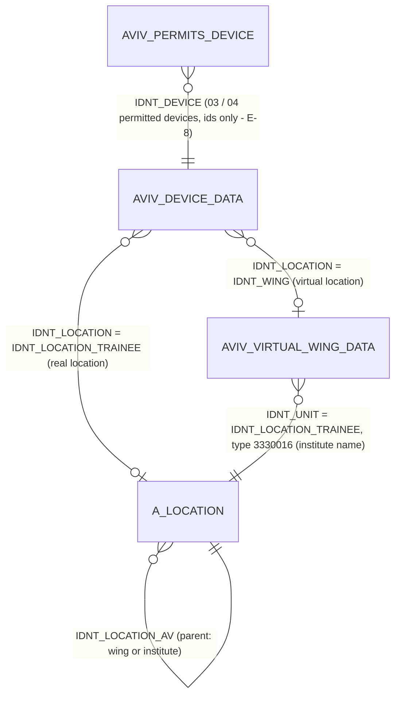

# Devices list – server side, phase 1: business analysis

Status: approved by the product owner on 2026-11-10 (two review rounds, answered inline in the planning file and in the dialog). Decisions and open items are tracked in [decisions.md](decisions.md) (E-n, EQ-n, EC-n; the 03 / 04 decisions by their own ids); the architecture follows in [02-architecture.md](02-architecture.md).

Scope of this document: `POST Devices/GetInstituteDevices` – the active phone devices of one or more institutes (or wings), each with a display name and the wing it is grouped under in the "מכשירים מותרים" picker of the 03 and 04 forms (spec 00 §6, Q-7 of 04 "deferred" until now). It also settles a side effect on features 03 and 04: **where the device name is built** – here, and only here – so the three read procedures of 03 / 04 stop returning names and return device ids only (E-8).

Siblings written in the same session: [../trainees-list/](../trainees-list/01-business-analysis.md) (shares the institutes-or-wings input block) and [../lookups/](../lookups/01-business-analysis.md).

---

## 1. Inputs and sources

| Source | What it gave |
|---|---|
| Owner, in the request and in review (2026-11-10) | The device id shown in the name is `AVIV_DEVICE_DATA.IDNT_DEVICE` (our table); the location column is `IDNT_LOCATION` (the column `SP_AVIV_GET_LOCATIONS` still calls `IDNT_WING` with a "should be renamed" comment – it was); a removed device keeps its row with `LOGI_ACTIVE = 0`. **The display name is `"מכשיר" {IDNT_DEVICE}, {full location}`**, where the full location is `A_LOCATION.TEXT_NAME_FULL` (the whole hierarchy in one column) for a real location, and `{institute}, {virtual location}` for a virtual one ("מכשיר 15, הדר, חדר אוכל" – shown under "מיקומים שונים" in the picker). A real location whose parent is not a wing counts as virtual for grouping. The owner's first wording named `AVIV_PERMITS_DEVICE` as the devices table; see §5.1. The owner populates `AVIV_DEVICE_DATA` with real devices; no test script here |
| `reference/SP_AVIV_GET_LOCATIONS.sql` + `reference/service/LocationsOrchestrator.cs` (conceptual, G-4) | How a location's "wing for the client" is computed (`CalcParent`: parent is a wing → `LOCAT.IDNT_WING`, else the agreed virtual wing `99999`), how real and virtual locations are read (`A_LOCATION` with `LOGI_PAIL = 1`; `AVIV_VIRTUAL_WING_DATA` with `LOGI_IS_ACTIVE = 1`, `IDNT_UNIT` = the institute), how `HasDevice` finds devices by location, the institutes-or-wings input block |
| Feature 04 analysis (`../number-restrictions/01-business-analysis.md` §2) | `AVIV_PERMITS_DEVICE` is the link permit ↔ device (`IDNT_AVIV_PERMITS_FOR_RESTRICTION`, `IDNT_DEVICE`); `AVIV_DEVICE_DATA` is the devices table; the institute name join (`A_LOCATION` rows of type `3330016`, `TEXT_NAME_LOCATION`) |
| Features 03 / 04 procedures and C# | The three device result sets that join `AVIV_DEVICE_DATA.TEXT_DEVICE_NAME` (an assumed column, I-15 / Q-9): `SP_AVIV_GET_TRAINEE_RESTRICTIONS` set 2, `SP_AVIV_GET_TRAINEE_NUMBER_RESTRICTIONS_AND_PERMITS` set 3, `SP_AVIV_GET_RESTRICTIONS_FOR_PERMIT` set 4; `DeviceRow { ConditionsRowId, DeviceId, DeviceName }`, `RecordPartsAssembler.ToDevices`, the `Devices: List<LookupItemDto>` properties of three DTOs |
| Specs | `00_foundations.md` §6 (devices fetched per institute in the background after the trainees list, cached; every device belongs to a wing; institute-wide devices come in the virtual wing "מיקומים שונים"); 03 / 04 form specs (the devices field: "כל המכשירים" when empty) |
| Client contract | `organization.schema.ts` (`GetInstituteDevicesRequest { instituteIds }`, `DeviceDto { id, name, instituteId, wingId }`, `{ devices }`), `devicesService.ts` (`devicesCache`, `prefetchInstituteDevices`), `formReferenceData.ts` (`useInstituteDevices`), `organizationLogic.ts` (`buildDeviceOptions` groups by `wingId` in the institute's wing order, `buildWingLabel`), the cards that show device names: `callConditionsLogic.ts` (`buildPermittedDevicesValue`), `sourceRestrictionPickerLogic.ts`, `numberRestrictionsLogic.ts`, `traineeRestrictionsLogic.ts` |
| Mock server | `devicesMockData.ts` (17 devices with free-text names, each with a wing; "office" devices in a virtual wing), `lookupsHandlers.ts` (`handleGetInstituteDevices` filters by institute) |

---

## 2. Tables and relations

### 2.1 `AVIV_DEVICE_DATA` – the devices (ours)

| Role | Column | Status |
|---|---|---|
| Device key, and the number in the display name | `IDNT_DEVICE` | confirmed (owner) |
| The device's location: a real `A_LOCATION.IDNT_LOCATION_TRAINEE` **or** a virtual `AVIV_VIRTUAL_WING_DATA.IDNT_WING` | `IDNT_LOCATION` | confirmed (owner); the two id spaces are assumed disjoint, as `SP_AVIV_GET_LOCATIONS` assumes (EQ-1) |
| Active; a removed device is 0 | `LOGI_ACTIVE` | confirmed (owner) |

There is **no name column**: the name is composed (E-3). The generic audit columns exist and are not read.

### 2.2 Location tables (ODS and ours)

| Table | Gives | Status |
|---|---|---|
| `ODSINTERNALDATA..A_LOCATION` (the real location) | `TEXT_NAME_FULL` – the full hierarchy as one text (owner); `IDNT_INSTITUTION`; `IDNT_LOCATION_AV` (parent) and `IDNT_WING` for the logical wing; `CODE_SUG_LOCATION` (3330016 institute, 3330017 wing) | columns seen in the reference; the separator inside `TEXT_NAME_FULL` and whether it starts with the institute name are checked in SSMS (EQ-2) |
| `ODSINTERNALDATA..A_LOCATION` (the parent row) | `CODE_SUG_LOCATION` of the parent: is it a wing? | reference (`CalcParent`) |
| `ODSINTERNALDATA..A_LOCATION` (the institute row, type 3330016) | `TEXT_NAME_LOCATION` – the institute's name for a virtual location's composed name | the join 04 uses for institute names (I-15) |
| `ZeroThree03.dbo.AVIV_VIRTUAL_WING_DATA` (the virtual location) | `IDNT_WING` (the id a device's `IDNT_LOCATION` points at), `TEXT_WING_NAME`, `IDNT_UNIT` (institute), `LOGI_IS_ACTIVE` | reference |
| `ODSINTERNALDATA..MAIN_WINGS_TABLE` | wing → institute, for the input block only | reference |

### 2.3 Entity-relationship diagram

### 2.4 One device, three cases

| The device's `IDNT_LOCATION` points at | `IdntWing` (for grouping) | `TextDeviceName` |
|---|---|---|
| A real location whose parent is a **wing** | `LOCAT.IDNT_WING` | `מכשיר 12, ` + `TEXT_NAME_FULL` → "מכשיר 12, הדר, אגף א, חדר 3" |
| A real location whose parent is **not a wing** (the institute itself) | `99999` ("מיקומים שונים") | `מכשיר 15, ` + `TEXT_NAME_FULL` → "מכשיר 15, הדר, מרפאה" |
| A **virtual** location (`AVIV_VIRTUAL_WING_DATA`) | `99999` | `מכשיר 15, ` + institute name + `, ` + `TEXT_WING_NAME` → "מכשיר 15, הדר, חדר אוכל" |

Exactly the three cases `SP_AVIV_GET_LOCATIONS` distinguishes for a location; the picker groups the last two under the virtual wing, which `GetInstitutionsAndWings` returns for every institute with `IsVirtualContainer = 1` (owner).

---

## 3. What the client assumes, and how the mock behaves

- Request: `instituteIds: number[]` (one institute today). Becomes `idntInstitutionList` + `idntWingList` with the institutes-or-wings semantics of the sibling query (E-7, EC-1).
- Record: `DeviceDto { id, name, instituteId, wingId }`. `instituteId` is read nowhere in the client today; it stays because the server has it for free and the cache key is the institute (E-6 keeps all four).
- Grouping: `buildDeviceOptions` groups by `wingId` in the institute's wing order and labels a group "אגף {name}" or, for a virtual wing, its name. Unchanged in logic; the field names change (EC-1).
- Names in the histories: the 03 / 04 records carry `devices: LookupItem[]` and the cards print `device.name`. After E-8 the records carry `idntDeviceList: number[]`, the cards resolve names through the cached devices list (`useInstituteDevices`), and a device that is not in the list (removed, `LOGI_ACTIVE = 0`) is shown with the fallback text **"מכשיר {id} – לא פעיל"** (EC-2; wording proposed, recorded in `.agent/pending-decisions.md`).
- Mock: 17 devices with free-text names ("טלפון ציבורי - אגף א"). Regenerated in the new format and shape (EC-3); ids 1–8 keep their meaning for the 03 / 04 mock records.
- Prefetch and cache stay as they are (spec 00 §6).

---

## 4. Field-by-field mapping (after the decisions)

| Client field (today) | Server field (phase 2) | Source | Status |
|---|---|---|---|
| `id` | `IdntDevice` | `AVIV_DEVICE_DATA.IDNT_DEVICE` | OK |
| `name` | `TextDeviceName` | composed in SQL (E-3) | OK |
| `wingId` | `IdntWing` | the logical wing (E-4): `A_LOCATION.IDNT_WING` or `99999` | OK |
| `instituteId` | `IdntInstitution` | `A_LOCATION.IDNT_INSTITUTION` / `AVIV_VIRTUAL_WING_DATA.IDNT_UNIT` | OK |
| request `instituteIds` | `IdntInstitutionList` (+ `IdntWingList`) | two `dbo.INT_TABLE` | EC-1 |
| 03 / 04 record `devices: LookupItem[]` | `IdntDeviceList: List<int>` | `AVIV_PERMITS_DEVICE.IDNT_DEVICE` only | E-8, EC-2 |

---

## 5. Findings and how they were resolved

### 5.1 Which table holds the devices (E-1)

The request named `AVIV_PERMITS_DEVICE` as "the devices, with their location". The 04 analysis had already read it as the link permit ↔ device, and `SP_AVIV_GET_LOCATIONS` finds devices by location in `AVIV_DEVICE_DATA` – the table the three 03 / 04 procedures also join. The owner confirmed in review: the id in the name is `AVIV_DEVICE_DATA.IDNT_DEVICE`, the location column is `IDNT_LOCATION`. Decision: `AVIV_DEVICE_DATA` is the devices table; `AVIV_PERMITS_DEVICE` stays the link.

### 5.2 The name (E-3)

The format `"מכשיר" {id}, {institute, wing, location}` says the name is composed, not stored – so `TEXT_DEVICE_NAME`, assumed by I-15 / Q-9, most likely does not exist. First proposal: compose it from two `A_LOCATION` joins (location + parent) with a `CASE` on the parent type; the owner then pointed at `A_LOCATION.TEXT_NAME_FULL`, which already holds the whole hierarchy – one join, no `CASE` for the name. A virtual location has no such column, so its name is composed from the institute's name (the `A_LOCATION` row of type 3330016, as 04 joins institutes) and `TEXT_WING_NAME`. The separator we add is a comma (owner); the separator inside `TEXT_NAME_FULL` is the ODS's and is checked in SSMS, together with whether the text begins with the institute name (EQ-2).

### 5.3 Where the name is built, and what the histories return (E-8)

The same name would be needed in the two histories and in the permit lookup (three result sets). Three ways were weighed: repeat the expression and the joins in each procedure under an identical header (A-3), a `VIEW`, or ids only with the client resolving names from the devices list it already caches. The owner chose **ids only**: the client prefetches the institute's devices after the trainees list and resolves a device by id. The price – a removed device (`LOGI_ACTIVE = 0`) is not in the picker's list, so an old record has no name for it – was weighed against returning inactive devices with an `IsActive` flag (rejected by the owner: it could bloat the list for an edge case) and settled with a client fallback text. Consequences: `DeviceRow` loses `DeviceName`; `RecordPartsAssembler.ToDevices` becomes `ToDeviceIds`; `TraineeRestrictionRecordDto`, `TraineePhoneRecordDto`, `ExistingPermitDto` carry `IdntDeviceList: List<int>` (symmetric with the request); the three procedures drop their `LEFT JOIN AVIV_DEVICE_DATA`; I-15 is amended in both logs.

### 5.4 Real, virtual, and "not under a wing" (E-2, E-4)

A device's `IDNT_LOCATION` is either a real location or a virtual one, in the same column – as `SP_AVIV_GET_LOCATIONS` checks `HasDevice` against both tables with the same column. The procedure reads the two cases in two steps into one temp table (real locations with their logical wing from the parent's type, then virtual locations with wing `99999`), and composes the name once from what the steps stored. A real location not under a wing gets `99999` too (owner: "נחשב לצורך כך כווירטואלי"), which is what `CalcParent` already does. The id spaces are assumed not to overlap (EQ-1); a device whose location is in neither table is not returned (EQ-3).

### 5.5 Flat response (E-6)

Four scalar fields, no pairs, no nullable pair: the row **is** the DTO. One class, `DeviceDto`, filled by Dapper and returned as the bare list (E-12, like `UnifiedLocationDto`); no assembler, no row class; the request record sits in the same file (`Models/Devices/DeviceDto.cs`). The trainees list is nested for the opposite reasons (L-7).

### 5.6 Active devices only (E-5)

The picker must not offer a device that is gone; `LOGI_ACTIVE = 1` on the device, `LOGI_IS_ACTIVE = 1` on a virtual location. The real location's own `LOGI_PAIL` is **not** filtered: a device is active or not by its own flag; whether a device on a closed location should disappear from the picker is EQ-4.

### 5.7 Test data (E-9)

The owner populates `AVIV_DEVICE_DATA` ("אני אטפל ב-AVIV_DEVICE_DATA"). No `00-test-data.sql` in this folder; the checklist runs the procedure against real devices of a development institute and checks the three cases of §2.4 by eye.

---

## 6. Schema changes to request from the DBA

None. `AVIV_DEVICE_DATA.IDNT_LOCATION` already carries the name the reference asked for; no index (A-1), no name column (E-3 composes it).

---

## 7. The query rule (input to phase 2)

`SP_AVIV_GET_DEVICES (@IDNT_INSTITUTION_LIST INT_TABLE, @IDNT_WINGS_LIST INT_TABLE)`, one result set, one row per active device of the requested institutes or wings:

1. `#ReqInstitutions`, `#ReqWings` – the block of `SP_AVIV_GET_LOCATIONS` (same header as in `SP_AVIV_GET_TRAINEES`).
2. `#Devices` ← active devices on **real** locations: institute, logical wing (parent is a wing → `IDNT_WING`, else `99999`), `TEXT_NAME_FULL`; kept when the institute or the logical wing is requested.
3. `#Devices` ← active devices on **virtual** locations (`LOGI_IS_ACTIVE = 1`): institute `IDNT_UNIT`, wing `99999`, name = institute name + `, ` + `TEXT_WING_NAME`; kept when the institute is requested or `99999` is.
4. The result: `IdntDevice`, `TextDeviceName = N'מכשיר ' + id + N', ' + stored location text`, `IdntWing`, `IdntInstitution`; `ORDER BY IdntInstitution, IdntWing, IdntDevice`.

No business check throws; no permission check (D-17).

---

## 8. Guidelines for phases 2 and 3

G-1 to G-5 of 04 and L-14 of the trainees list apply as written.

---

## 9. Client changes deferred

Tracked in [decisions.md section C](decisions.md): EC-1 (`DeviceDto` names and the request), EC-2 (records carry `idntDeviceList`; names resolved from the cache with the fallback text), EC-3 (mock data in the new format).

---

## 10. Open items

[decisions.md section Q](decisions.md): EQ-1 (id spaces of real and virtual locations), EQ-2 (`TEXT_NAME_FULL`: separator and whether it starts with the institute), EQ-3 (devices whose location is in neither table), EQ-4 (devices on an inactive real location). None blocks phase 2.
