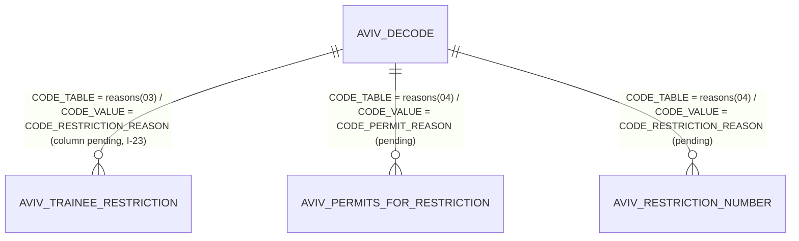

# Lookups (DECODE) – server side, phase 1: business analysis

Status: approved by the product owner on 2026-11-10 (two review rounds, answered inline in the planning file and in the dialog; one conflict with spec 00 §6 raised and resolved in favour of the spec). Decisions and open items are tracked in [decisions.md](decisions.md) (K-n, KQ-n, KC-n); the architecture follows in [02-architecture.md](02-architecture.md).

Scope of this document: the code-table query – the rows of one or more sets of `AVIV_DECODE`, read by the numeric set id (`CODE_TABLE`). Its first and only consumers today are the three reason lists of the "סיבות ואישורים" block (spec 00 §4.3, §6): trainee restriction, number restriction / permit, voice message. The client calls three placeholder actions (`Lookups/Get{TraineeRestriction,PhoneException,VoiceMessage}Reasons`); they are replaced by one generic action (K-3).

Siblings written in the same session: [../trainees-list/](../trainees-list/01-business-analysis.md), [../devices/](../devices/01-business-analysis.md).

---

## 1. Inputs and sources

| Source | What it gave |
|---|---|
| Owner, in the request and in review (2026-11-10) | The table is **`AVIV_DECODE`** (ours, in `ZeroThree03`), not `DECODE` as the 04 documents assumed; `CODE_TABLE` is **numeric** (a table id); the code is numeric; `LOGI_ACTIVE` and `SORT_ORDER` exist; the DBA inserts the rows. The three reason lists stay **three sets**, as spec 00 §6 says (conflict resolved 2026-11-10). The API is **one generic action with an array of table ids**, and the response carries, beside each table's number, **a name** so that a debugger sees what the number means. **The client keeps its mock reasons as a fallback** wherever a list arrives empty, until `AVIV_DECODE` is populated |
| Feature 04 (`../number-restrictions/decisions.md` D-10, I-23; `stored-procedures/schema/01-proposed-schema-changes.sql` §1) | Two sets were proposed for `DECODE` as text names (`AVIV_RESTRICTION_TYPE`, `AVIV_RESTRICTION_SCOPE`); the reason codes travel in the save requests (`codeRestrictionReason`, `codePermitReason`) and are not stored until the DBA adds the columns. The §1 proposal is superseded by `AVIV_DECODE` (K-5) |
| Specs | `00_foundations.md` §4.3 ("identical in every form, except for the reason list"), §6 (the three lists with their five values each, "a DECODE set per list, read by CODE_TABLE"), §7 ("Lookup endpoints accept arrays where cost is low") |
| Client contract | `reasonsService.ts` (`ReasonListKey`: `traineeRestriction`, `phoneException`, `voiceMessage`; one endpoint per key; `reasonsCache`), `formReferenceData.ts` (`useReasons(listKey)` in the three form sessions), `serviceEndpoints.ts` (`lookups.*`), `reasonsMockData.ts` (three lists), `lookupsHandlers.ts` |
| Spec 03 form §7 | "The reason is required, so saving waits for the reasons list" – why prefetching the lists is worth something |

---

## 2. Tables and relations

### 2.1 `AVIV_DECODE` – the code tables (ours)

| Role | Column | Status |
|---|---|---|
| The set (table id), numeric | `CODE_TABLE` | confirmed (owner) |
| The code inside the set, numeric – what the client sends back as `codeRestrictionReason` / `codePermitReason` | `CODE_VALUE` | **assumed name** (KQ-2) |
| The display text | `TEXT_DESCRIPTION` | **assumed name** (KQ-2) |
| Active row | `LOGI_ACTIVE` | confirmed |
| Display order | `SORT_ORDER` | confirmed |

The table is the DBA's to fill (K-5); this repository writes no rows and no DDL for it.

### 2.2 The sets the client needs

| Set | Serves | Values (spec 00 §6) | `CODE_TABLE` |
|---|---|---|---|
| Reasons – trainee restriction | `AVIV_TRAINEE_RESTRICTION.CODE_RESTRICTION_REASON` (I-23, column pending) | "הפרת משמעת", "שימוש לא תקין בטלפון", "בקשת גורם טיפולי", "בקשת הורים", "אחר" | not fixed yet (KQ-1) |
| Reasons – number restriction / permit | `CODE_RESTRICTION_REASON` / `CODE_PERMIT_REASON` (I-23) | "מורשה לזמן מוגבל", "קשר עם בן משפחה", "קשר עם גורם טיפולי", "בקשת הורים", "אחר" | not fixed yet (KQ-1) |
| Reasons – voice message | feature 05 (outside this scope) | "זיהוי מקור השיחה", "בקשת הורים", "בקשת גורם טיפולי", "הנחיית הנהלה", "אחר" | not fixed yet (KQ-1) |

Not in the registry: the restriction type and scope sets (1 trainee / 2 number; 1 general / 2 trainee). The client never asks for them and the procedures keep them as `DECLARE` constants, not as lookups (K-7, ש-18).

### 2.3 Relation to the forms

---

## 3. What the client assumes, and how the mock behaves

- Three GET endpoints, each returning a bare `LookupItem<number>[]`, loaded when a form opens and cached per key for the session; the form's reason field is required and the save waits for the list.
- The mock serves the three constant lists of `reasonsMockData.ts`.
- After K-3 / K-6: one POST with the three table numbers, prefetched together with the devices after the trainees list loads; the response is split by `codeTable` into the three cache keys; an empty `items` for a key → that key's mock list (the owner's instruction, until the DBA fills the table); `useReasons(listKey)` in the forms does not change.

---

## 4. Field-by-field mapping (after the decisions)

| Client (today) | Server (phase 2) | Source | Status |
|---|---|---|---|
| `GET Lookups/Get*Reasons` ×3 | `POST Lookups/GetDecode { codeTableList }` | – | K-3, KC-1 |
| response `LookupItem<number>[]` per key | `{ tables: [{ codeTable, codeTableName, items: [{ id, name }] }] }` | `CODE_TABLE`; `DecodeTables` name; `CODE_VALUE`, `TEXT_DESCRIPTION` | K-3 |
| `item.id` → `codeRestrictionReason` / `codePermitReason` | `Id` | `CODE_VALUE` | OK (I-23) |
| `item.name` | `Name` | `TEXT_DESCRIPTION`, active rows, `SORT_ORDER` | OK |
| the three keys | the three numbers in `config/decodeTables.ts` ↔ `Utils/DecodeTables.cs` | – | KQ-1 |

---

## 5. Findings and how they were resolved

### 5.1 `AVIV_DECODE`, not `DECODE`; numbers, not names (K-1, K-5)

Every 04 document and the §1 of the 04 schema script talk about `dbo.DECODE` with text set names ("OPEN: confirm the DECODE column names"). The owner: the table is `AVIV_DECODE`, the set key is a number, the DBA fills it. The §1 proposal of the 04 script is superseded (a note is added there; no insert is written here). The set *names* therefore do not exist in the database at all – they live in the server registry only (K-3), one per number, next to a comment naming the column the set serves.

### 5.2 One list or three (conflict, resolved for the spec; K-4)

In review the owner wrote that the reasons are the same in every operation. That contradicts spec 00 §4.3 ("except for the reason list") and §6 (three different lists), and the client built on them. Raised as a conflict (CLAUDE.md rule), the owner chose **three lists, as in the spec**. Three sets in `AVIV_DECODE`, three keys in the client.

### 5.3 Generic or named API (K-3)

The owner was undecided between a generic action (the client sends table numbers) and named actions (`Get…Reasons`, the server holds the numbers), and asked for the considerations; then asked whether the lists could be fetched together, "if worthwhile at all". Recorded in the planning file §4ב.3 / §4ב.6: the procedure, repository and orchestrator are generic in every shape, so the choice is only about the controller and about who holds the numbers; fetching the three together is worth a little (forms open with the lists ready, one fallback point) and costs ~10 lines. The owner chose **the generic action with an array**, plus **the table's name in the response** for debugging. Consequence of the name: the server must know the tables – `Utils/DecodeTables.cs` is both the name map and the allowed list (an unknown number is a 400, not an empty table), so a new set needs a constant on both sides. Accepted as the price of the readable response.

### 5.4 Mock fallback in the client (K-6)

The owner's explicit instruction: "אני רוצה שבקליינט … נמשיך להשתמש ב-MOCK (לפי תנאי, אם לא הגיע רשימה מהשרת), עד שהטבלה AVIV_DECODE תהיה מוכנה בפועל". Implemented in the client's service layer, per key: an empty `items` → the mock list of that key; components never touch mock data (CLAUDE.md). A pending-decisions row says to remove the fallback when the table is populated.

### 5.5 Why the procedure takes a list (K-2)

Spec 00 §7: lookup endpoints accept arrays where cost is low; every procedure of ours takes a TVP; and the "together" the owner asked for needs it. `@CODE_TABLE_LIST dbo.INT_TABLE` → rows `CodeTable, Id, Name`, active only, ordered by table then `SORT_ORDER`. A requested table with no rows yields nothing from SQL; the service still returns it with empty `items`, so the client can fall back per key (K-3).

---

## 6. Schema changes to request from the DBA

None here. The DBA fills `AVIV_DECODE` (K-5); the three set numbers are asked from the DBA (KQ-1). The §1 insert proposal of `stored-procedures/schema/01-proposed-schema-changes.sql` is marked superseded.

---

## 7. The query rule (input to phase 2)

`SP_AVIV_GET_DECODE (@CODE_TABLE_LIST INT_TABLE)` → one result set: `SELECT DECODE.CODE_TABLE AS CodeTable, DECODE.CODE_VALUE AS Id, DECODE.TEXT_DESCRIPTION AS Name FROM dbo.AVIV_DECODE … JOIN @CODE_TABLE_LIST … WHERE LOGI_ACTIVE = 1 ORDER BY CODE_TABLE, SORT_ORDER`. No temp tables needed; one statement under one header.

---

## 8. Guidelines for phases 2 and 3

G-1 to G-5 and L-14 apply.

---

## 9. Client changes deferred

[decisions.md section C](decisions.md): KC-1 (one endpoint, `config/decodeTables.ts`, `reasonsService` fetches once and splits), KC-2 (mock fallback per key), KC-3 (mock handler for the generic endpoint).

---

## 10. Open items

[decisions.md section Q](decisions.md): KQ-1 (the three table numbers – from the DBA), KQ-2 (the code and text column names), KQ-3 (does the DBA keep a table of tables with names, which could replace the server registry). None blocks phase 2; the client is on mock until KQ-1 is answered anyway.
