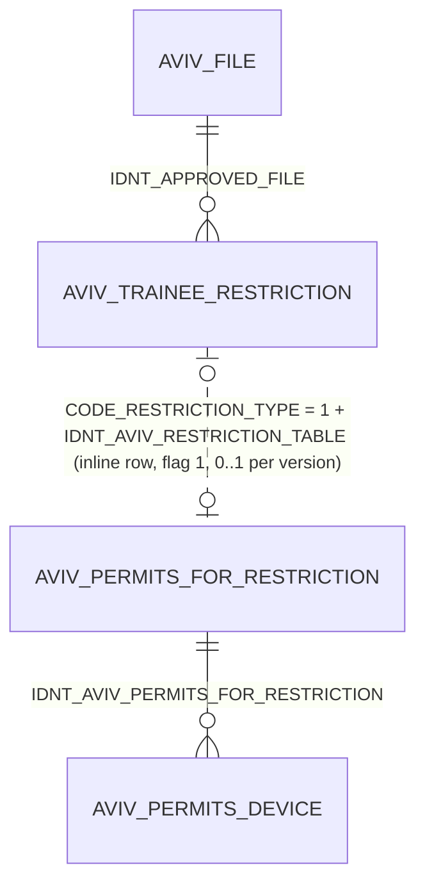

# Trainee restrictions – server side, phase 1: business analysis of the schema

Status: approved by the product owner on 2026-11-09 (one review round in two parts). Decisions and open items are tracked in [decisions.md](decisions.md) (T-n, TQ-n, TC-n; the 04 decisions by their own ids); the architecture follows in [02-architecture.md](02-architecture.md) (phase 2).

Scope of this document: feature 03, "הגבלות לחניך" – a restriction of **all** calls of one trainee for a date range, with an optional call-duration cap and optional permitted hours and devices. It checks the DBA's table `AVIV_TRAINEE_RESTRICTION` against the product spec (`.agent/specs/03-trainee-restriction/*`, `.agent/specs/00_foundations.md`) and the client contract (`src/types/trainee-restrictions.schema.ts`, `src/types/common.schema.ts`), records what was decided, and lists the schema change to request from the DBA. It does not design controllers or procedures; that is phase 2.

Relation to feature 04 ([../number-restrictions/01-business-analysis.md](../number-restrictions/01-business-analysis.md)): 03 reuses the shared tables, the versioning model and every convention of 04. Decisions closed there are verified for 03 in decisions.md section V and are not re-opened here; this document explains only what is specific to 03.

---

## 1. Inputs and sources

| Source | What it gave |
|---|---|
| `AVIV.xlsx`, `TABLE_NAMES.txt`, `COLUMNS.txt` (DBA export, 2026-10-29) | The non-generic columns of `AVIV_TRAINEE_RESTRICTION` and the DBA's note that `AVIV_PERMITS_FOR_RESTRICTION` is a child of `AVIV_TRAINEE_RESTRICTION` as well. **The export predates one column**: `TEXT_RESTRICTION_REASON` exists on the table (owner, 2026-11-09) but is not listed – TQ-2 |
| Generic columns (excluded from the export, present on every table) | `DATE_CREATED`, `DATE_UPDATED`, `LOGI_ACTIVE`, `IDNT_USER_UPDATE`, `LAST_REQUEST_UID`, `LAST_SUCCESS_REQUEST_UID`, `IDNT_CANCELLED_FILE` |
| Owner, in review | `TEXT_RESTRICTION_REASON` exists; `CODE_RESTRICTION` is `int NULL`; `RESTRICTION_UID` is left empty for now |
| Feature 04 documents and code | `../number-restrictions/decisions.md`, `../number-restrictions/02-architecture.md`, `../number-restrictions/03-manual-test-checklist.md`, `stored-procedures/number-restrictions/*.sql`, `stored-procedures/schema/01-proposed-schema-changes.sql`, `service-layer/**/*.cs` – the conventions 03 continues |
| Specs | `03_trainee_restriction_overview.md` (§2 rules, §3 derived values, §5 API), `03_trainee_restriction_history.md` (§4 behaviour, §6 data), `03_trainee_restriction_form.md` (§1–§2 modes, §4.7 submit, §5 validation, §6 mapping, §7 errors); `00_foundations.md` §4.3 (reasons and decision block), §5 (formats), §6 (lookups), §7 (API conventions) |
| Client contract | `trainee-restrictions.schema.ts`, `common.schema.ts`, `serviceEndpoints.ts` (`traineeRestrictions.*`, `lookups.getTraineeRestrictionReasons`) |
| Mock server (the "server" the client was built against) | `src/mock-server/handlers/traineeRestrictionsHandlers.ts`, `mutationHelpers.ts`, `recordInputValidation.ts`, `src/mock-server/data/traineeRestrictionsMockData.ts`; the trainees list derives its restriction flags from the same mock data (`traineesHandlers.ts`) |
| House-style references (conceptual, G-4) | `reference/SP_AVIV_GET_LOCATIONS.sql`, `reference/service/*.cs` |

---

## 2. Tables and relations

### 2.1 `AVIV_TRAINEE_RESTRICTION` – the record

One row per trainee restriction version. Beside the generic columns:

| Column | Type (export) | Role in 03 | Decision |
|---|---|---|---|
| `IDNT_AVIV_TRAINEE_RESTRICTION` | int, PK | The client's `id`; `@IDNT_PREVIOUS` of an update | I-11 (IDENTITY assumed) |
| `IDNT_AVIV_TRAINEE_DATA` → **`IDNT_TRAINEE`** | int | The trainee | D-12, T-8 (`sp_rename`) |
| `RESTRICTION_UID` | uniqueidentifier | **Left empty**; not written, not returned | T-1, TQ-1 |
| `CODE_RESTRICTION` | int NULL | Not written | D-8, T-5 |
| `DATE_RESTRICTION_START` / `DATE_RESTRICTION_END` | datetime | The date range; comparisons cast to `DATE`, end day inclusive | A-8 |
| `NUMB_DURATION_LIMIT` | int | The call-duration cap; NULL = full restriction (spec 03 §2.2) | T-2 |
| `TEXT_RESTRICTION_REASON` *(not in the export, exists)* | varchar | The free-text details ("פירוט") | T-3, D-6, P-9, I-14 |
| `IDNT_APPROVED_FILE` | int | → `AVIV_FILE` | D-13 |
| `IDNT_USER_APPROVAL` | int | The approver | D-14, Q-1 |

### 2.2 Shared tables, in their 03 role

| Table | Role in 03 | Values that identify a 03 row |
|---|---|---|
| `AVIV_PERMITS_FOR_RESTRICTION` | **The inline conditions row** of a restriction: permitted hours (`TIME_PERMIT_START` / `END`), the restriction's dates copied (`DATE_PERMIT_START` / `END`, I-2), the trainee (`IDNT_TRAINEE`). At most one active row per restriction version; **present only when the restriction has hours or devices** (T-2). `NUMB_DURATION_LIMIT`, `TEXT_PERMIT_REASON`, approval, institute and location columns stay NULL (P-3, P-6) | `CODE_RESTRICTION_TYPE = 1` (`DECODE AVIV_RESTRICTION_TYPE`, D-10), `LOGI_RESTRICTION_INLINE_PERMIT = 1` (D-3), `IDNT_AVIV_RESTRICTION_TABLE` = `IDNT_AVIV_TRAINEE_RESTRICTION` |
| `AVIV_PERMITS_DEVICE` | The permitted devices of the inline row, `DISTINCT` (A-1), deactivated with it (P-4) | `IDNT_AVIV_PERMITS_FOR_RESTRICTION` = the inline row |
| `AVIV_FILE` | The approval file (SharePoint path), one row per save, inserted by the procedure | `IDNT_AVIV_FILE` = `IDNT_APPROVED_FILE` |
| `DECODE` | `AVIV_RESTRICTION_TYPE = 1` means "trainee restriction" | already proposed in the 04 script |

Not used by 03: `AVIV_LIST_PHONE_NUMBER`, `AVIV_RESTRICTION_NUMBER`, `AVIV_TRAINEE_RESTRICTION_NUMBER`, `AVIV_INSTITUTES_RESTRICTION_NUMBER`.

### 2.3 Entity-relationship diagram

Dotted line = polymorphic reference (`CODE_RESTRICTION_TYPE` says which table `IDNT_AVIV_RESTRICTION_TABLE` points to).

### 2.4 How one client record spreads over the tables

| Client record (spec 03) | Rows |
|---|---|
| **Trainee restriction** (`TraineeRestrictionRecordDto`) | One `AVIV_TRAINEE_RESTRICTION` row (trainee, dates, duration, details, approver, file; this row's id is the client's `id`) + **0 or 1** inline `AVIV_PERMITS_FOR_RESTRICTION` row (hours; present only with hours or devices) + 0..n `AVIV_PERMITS_DEVICE` rows + one `AVIV_FILE` row per save |

Examples, from the interpretation table of spec 03 §2.3:

| Restriction | Rows written |
|---|---|
| Full, nothing permitted | 1 restriction row (`NUMB_DURATION_LIMIT` NULL), 1 file row |
| Duration 10, no hours, no devices (the common therapeutic case) | 1 restriction row (`NUMB_DURATION_LIMIT` 10), 1 file row |
| Full, 16:00–18:00 | 1 restriction row, 1 inline row (times), 1 file row |
| Duration 10, device A | 1 restriction row (10), 1 inline row (no times), 1 device row, 1 file row |

---

## 3. What the client assumes, and how the mock behaves

- Record: `id` is the row id; `restrictionUid` is a logical id the mock keeps across versions (`TR-<id>`); `restrictionCode` is a placeholder constant (`PLACEHOLDER_RESTRICTION_CODE = 1`) that nothing reads. Both leave the DTO (TC-1, TC-2).
- Conditions: `durationMinutes` (null = full), `startTime` / `endTime` (both or none), `devices[]` with names; the client derives the type label, "open by default", and the hours / devices texts (spec 03 §3). The server returns the raw values and the `IsEnded` flag only (I-19, C-11).
- Update: `previousRestrictionId` + `traineeId`; the mock takes the trainee from the previous record and ignores the sent one; 404 when unknown, 409 when already replaced or ended. The server merges 404 into 409 (A-2) and drops `traineeId` from the request (T-9, TC-3).
- Validation: the mock repeats every form rule with Hebrew messages (`recordInputValidation.ts`); the server returns 400 with field names only (D-18, C-4).
- The form requires a reason from the list and the mock stores its name; the server does not (D-7, TQ-3). The reasons endpoint `Lookups/GetTraineeRestrictionReasons` is not built.
- Mutation result: `createdIds[]` (the client opens the first), `requestUid`, `syncStatus`; the server returns `createdIds` only (A-14, C-12).
- After a save the client clears its trainees cache, because the trainees list derives "מוגבל עד" and the restriction flags from these rows (`traineeRestrictionsService.ts`); that query is Q-8 (deferred) and reads `AVIV_TRAINEE_RESTRICTION` directly – one reason for T-2.
- The acting user is not sent by the client (D-14). No server paging (B-5).

---

## 4. Field-by-field mapping (after the decisions)

| Client field | Table.column | Status |
|---|---|---|
| `id` | `AVIV_TRAINEE_RESTRICTION.IDNT_AVIV_TRAINEE_RESTRICTION` | OK |
| `restrictionUid` | `RESTRICTION_UID` | **not returned** (T-1, TC-2) |
| `traineeId` | `IDNT_TRAINEE` (after the rename) | OK (D-12) |
| `restrictionCode` | `CODE_RESTRICTION` | **not stored, not returned** (D-8, T-5, TC-1) |
| `startDate` / `endDate` | `DATE_RESTRICTION_START` / `END` | OK (A-8) |
| `durationMinutes` | `AVIV_TRAINEE_RESTRICTION.NUMB_DURATION_LIMIT` | OK (T-2) |
| `startTime` / `endTime` | inline row: `TIME_PERMIT_START` / `END` | OK (D-2, A-8); null when there is no inline row |
| `devices[]` | `AVIV_PERMITS_DEVICE` of the inline row, names from `AVIV_DEVICE_DATA` | OK (A-1, I-15, C-8) |
| `reason` / `reasonCode` | not stored | D-7 (C-2, TQ-3) |
| `details` | `TEXT_RESTRICTION_REASON` | OK (T-3) |
| `approver` | `IDNT_USER_APPROVAL`; name empty | OK (Q-1, C-8) |
| `approvedFile` | `IDNT_APPROVED_FILE` → `AVIV_FILE.TEXT_FILE`, name from the path | OK (D-13, C-1) |
| `isActive`, `temporalStatus`, `syncStatus` | → the procedure flag `IsEnded` only | C-11, C-12 |
| `createdAt` / `updatedAt` / `updatedByUserId` | `DATE_CREATED` / `DATE_UPDATED` / `IDNT_USER_UPDATE` of the restriction row | OK (I-18) |
| request `traineeIds[]` | `dbo.INT_TABLE`; one restriction row per trainee | OK (P-12) |
| request `previousRestrictionId` (+ `traineeId`) | `@IDNT_PREVIOUS`; the trainee is read from the claimed row | `traineeId` dropped (T-9, TC-3) |
| request `approvedFileId` | → `TextFile` (+ `TextFileName`); the procedure inserts `AVIV_FILE` | C-1 (D-13) |
| request `deviceIds[]` | `dbo.INT_TABLE`, `DISTINCT` | OK |
| `createdIds[]` | the new `IDNT_AVIV_TRAINEE_RESTRICTION` values | OK (A-14) |
| `Lookups/GetTraineeRestrictionReasons` | – | not built (D-7, C-2) |

---

## 5. Findings and how they were resolved

### 5.1 `RESTRICTION_UID` (T-1)

A `uniqueidentifier` (GUID) on every restriction row, with no counterpart on `AVIV_RESTRICTION_NUMBER`. Two readings were possible: Cellcom's identifier of the trainee block (like `PHONE_NUMBER_UID`, B-7), or a logical id of ours that survives versions (what the client's mock does). `LAST_REQUEST_UID` is neither: it changes with every save (D-19). Decision: **left empty for now** – not written, not returned; `restrictionUid` leaves the client DTO. If the DBA says the column is ours, the change is `NEWID()` on create and a copy on update. Nullability is checked before the first run (TQ-1).

### 5.2 Where the conditions live – the D-9 hybrid re-examined (T-2)

The question: for "duration 10, no hours, no devices", one row (the cap on `AVIV_TRAINEE_RESTRICTION.NUMB_DURATION_LIMIT`, no inline row) or two rows as in 04 (NULL on the restriction, the cap on the inline row)?

| Consideration | Hybrid (kept) | Aligning to 04 |
|---|---|---|
| Spec 03 §2.1: "dates and call duration belong to the restriction; permitted hours and devices define when and where calls are allowed" | Direct implementation: the duration is the restriction's type (§2.2) | The type would live in a "permit" row, against the spec's wording |
| The DBA's model: `NUMB_DURATION_LIMIT` exists on `AVIV_TRAINEE_RESTRICTION` and on `AVIV_PERMITS_FOR_RESTRICTION`, not on `AVIV_RESTRICTION_NUMBER` | Exactly this: a trainee restriction has its own cap; a number restriction's cap is per trainee through the permit row | Leaves the DBA's column always NULL |
| The consumer (the system that talks to the devices reads these tables) | No new risk | A reader that expects the cap on the restriction row sees NULL and may treat "10 minutes" as a full block |
| Trainees list (spec 01: "מוגבל עד", full / minutes flags and filter; Q-8) – the most frequent query | One table | A join to the inline row only to learn the type |
| Row count for the common "duration only" case | One row | Two rows, and two deactivations per update |
| A future user permit inside a trainee restriction | A flag-0 row of type 1 with its own cap: "a row's cap is that row's cap" | Also possible |
| The 04 reasoning of D-2 ("the parent is shared, so the duration cannot sit on it") | Does not apply: the 03 row is already per trainee | – |
| Cost | Documentation: a reader of `AVIV_PERMITS_FOR_RESTRICTION` sees the cap on flag-1 rows of type 2 and never on type 1 (T-10 tells the job owner) | One rule for both features |

Decision: **hybrid**, stated as 03's rule – the cap on the restriction row; an inline row only when there are hours or devices; the inline row's own `NUMB_DURATION_LIMIT` stays NULL.

### 5.3 Details column (T-3)

Spec 03 form §5 requires details and the card shows them; the export had no column for it. The owner confirmed that `AVIV_TRAINEE_RESTRICTION.TEXT_RESTRICTION_REASON` exists, so the export is older than the column. No DBA request; the real column list, length and collation are re-read before phase 3 runs (TQ-2). The alternative – details on the inline row – was rejected because it would force an inline row on every restriction (against T-2 and P-3).

### 5.4 `CODE_RESTRICTION` (T-5)

Not stored (D-8). The column is `int NULL`, so the inserts simply omit it. The product question behind it (the form demands a reason the server drops) is Q-12 of 04 and applies to 03; recorded as TQ-3, to be moved by the owner to `.agent/pending-decisions.md`.

### 5.5 Approval columns (T-4)

`IDNT_USER_APPROVAL` and `IDNT_APPROVED_FILE` on the restriction row cover `DecisionApprovalDto` together with `TEXT_RESTRICTION_REASON`; `reason` is not stored. The inline row and the device rows keep their approval columns NULL (P-3).

### 5.6 The update request (T-9)

`UpdateTraineeRestrictionRequest` carries `traineeId` beside `previousRestrictionId`. The server takes the trainee from the row it claims, as 04 does for a permit's restriction (D-1); the field is dropped (TC-3). A restriction can never be moved to another trainee through an update.

### 5.7 The history and the number of procedures (T-6)

The history returns every `LOGI_ACTIVE = 1` row of the requested trainees (B-5) with `IsEnded` and `ConditionsRowId` from the procedure (I-19), in two result sets: restrictions (restriction row + inline row + file path) and devices keyed by `ConditionsRowId`. 03 has one kind of record, no scope and no lookup, so there is no further query: three actions, three procedures. The devices list of the form is `Devices/GetInstituteDevices` (Q-7, deferred); the trainees-list flags are Q-8 (deferred).

### 5.8 Set-based create (T-11)

Unlike 04's parent row (I-1), `AVIV_TRAINEE_RESTRICTION` carries `IDNT_TRAINEE`, so a set-based `INSERT … OUTPUT INSERTED.IDNT_AVIV_TRAINEE_RESTRICTION, INSERTED.IDNT_TRAINEE` can map every new row to its trainee, and the inline rows can follow the same way. Loop or set is decided in phase 2 by readability (G-1).

---

## 6. Schema changes to request from the DBA

One change, delivered with the 04 script as a single request. The DDL is written in phase 3, batch 1, as `stored-procedures/schema/02-proposed-schema-changes-trainee-restrictions.sql`, re-runnable and checking before each step like the 04 script; section 8 of `01-proposed-schema-changes.sql` keeps a pointer to it.

| Table | Change | Status |
|---|---|---|
| `AVIV_TRAINEE_RESTRICTION` | `EXEC sp_rename 'dbo.AVIV_TRAINEE_RESTRICTION.IDNT_AVIV_TRAINEE_DATA', 'IDNT_TRAINEE', 'COLUMN'` – the trainee key unified across all tables | closed (D-12, T-8) |
| `AVIV_TRAINEE_RESTRICTION` | `TEXT_RESTRICTION_REASON`: exists, no change; length and collation to record (TQ-2) | closed (T-3) |
| `AVIV_TRAINEE_RESTRICTION` | `RESTRICTION_UID`, `CODE_RESTRICTION`: no change; nullability of `RESTRICTION_UID` to confirm (TQ-1) | closed (T-1, T-5) |
| `AVIV_PERMITS_FOR_RESTRICTION`, `AVIV_PERMITS_DEVICE`, `AVIV_FILE` | no change beyond the 04 script (`LOGI_RESTRICTION_INLINE_PERMIT` is the one 03 relies on) | – |
| `DECODE` | no new set: `AVIV_RESTRICTION_TYPE = 1` is in the 04 script | closed (D-10) |
| Not added | CHECK constraints, indexes, a reason column, a details column, UID handling | decided (D-18, A-1, T-1, T-3, T-5) |

---

## 7. Versioning rule for a trainee restriction (input to phase 2)

Inside one transaction with `SET XACT_ABORT ON` (T-7):

1. Read `IDNT_TRAINEE` of the previous row.
2. **Claim** the previous row: `UPDATE AVIV_TRAINEE_RESTRICTION SET LOGI_ACTIVE = 0, DATE_UPDATED, IDNT_USER_UPDATE, LAST_REQUEST_UID WHERE IDNT_AVIV_TRAINEE_RESTRICTION = @IDNT_PREVIOUS AND LOGI_ACTIVE = 1 AND CAST(DATE_RESTRICTION_END AS DATE) >= @Today`; `@@ROWCOUNT = 0` → `THROW 50409, 'idntPrevious', 1` (unknown, already replaced, or ended – spec 03 form §1–§2 lets the user edit active and future records only).
3. Deactivate the previous inline row (type 1, flag 1, `IDNT_AVIV_RESTRICTION_TABLE = @IDNT_PREVIOUS`, active) and its device rows (P-4).
4. Insert the `AVIV_FILE` row from the request's path (D-13).
5. Insert the new restriction row: the trainee from step 1, the request's dates, duration, details, approver, the file id.
6. When the request has hours or devices: insert the inline row (type 1, flag 1, trainee, the restriction's dates copied – I-2, the times) and its devices with `DISTINCT`.
7. No re-pointing: nothing else refers to a trainee restriction.
8. `SELECT @NewId AS CreatedId`.

Create is steps 4–6 and 8 for every trainee in the list, in one transaction (P-12), with the required-field check of I-12 first (empty list → 400 `idntTraineeList`). Every written row carries the audit columns and `LAST_REQUEST_UID = @REQUEST_UID` (D-19).

Business rules the procedures enforce (D-18): the claim of step 2 (409) and the required trainee list (400). Date order, duration 1–120, the hours pair (both or none, end after start – OQ-13 as in 04), device ids, details length, approver and file are enforced by the service validator (section 6 of the 04 architecture, repeated for 03 in phase 2).

---

## 8. Guidelines for phases 2 and 3

G-1 to G-5 of [../number-restrictions/decisions.md](../number-restrictions/decisions.md) apply as written: readability first, procedures and service code kept in this repository, queries designed too (here: the history only), the `reference/` examples are conceptual, one procedure per save.

---

## 9. Client changes deferred

Tracked in [decisions.md section C](decisions.md), with the "shared with 04" column and the items unique to 03 (TC-1 `restrictionCode`, TC-2 `restrictionUid`, TC-3 `traineeId` in the update request). The combined 03 + 04 summary there is completed at the end of phase 2.

---

## 10. Open items

[decisions.md section Q](decisions.md): TQ-1 (nullability of `RESTRICTION_UID`) and TQ-2 (the real column list, length and collation of `TEXT_RESTRICTION_REASON`) are settled by the checklist before the first run; TQ-3 (the reason the form requires, Q-12) belongs in `.agent/pending-decisions.md`; TQ-4 (other writers of the table) is checked when the DDL is applied; TQ-5 (T-10 to the job owner) is a communication. None of them blocks phase 2.
