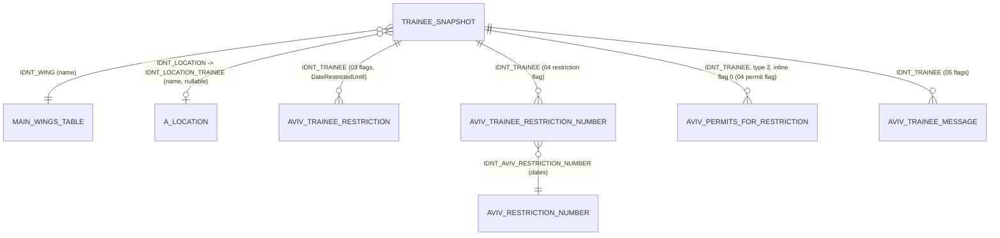

# Trainees list – server side, phase 1: business analysis

Status: approved by the product owner on 2026-11-10 (two review rounds, answered inline in the planning file and in the dialog). Decisions and open items are tracked in [decisions.md](decisions.md) (L-n, LQ-n, LC-n; the 03 / 04 decisions by their own ids); the architecture follows in [02-architecture.md](02-architecture.md).

Scope of this document: the query behind the home screen of the app – `POST Trainees/GetTrainees`, the list of the **current** trainees of one or more institutes (spec `01_children_list.md`), with the wing and location of each trainee, the "מוגבל עד" date and the status flags the cards and the filters read. It checks the ODS table `ODSINTERNALDATA..TRAINEE_SNAPSHOT` and the Aviv tables that feed the flags against the spec and the client contract (`src/types/trainees.schema.ts`), records what was decided, and lists what is still assumed. The design of the procedure and the C# is phase 2.

Relation to features 03 and 04 ([../trainee-restrictions/](../trainee-restrictions/decisions.md), [../number-restrictions/](../number-restrictions/decisions.md)): the flags of this list are **read-only derivations** of the tables those features write (Q-8 of 04, "deferred" until now). Every rule about what "active today" means, which rows count and how dates compare is taken from there and verified in decisions.md section V; this document explains only what is specific to the list.

Written together with two sibling queries that share the same input block and the same session: [../devices/](../devices/01-business-analysis.md) and [../lookups/](../lookups/01-business-analysis.md).

---

## 1. Inputs and sources

| Source | What it gave |
|---|---|
| Owner, in review (2026-11-10) | `TRAINEE_SNAPSHOT`: the trainee key is `IDNT_TRAINEE` (the same key every Aviv table points at, D-12); the personal number is numeric; the full name is first name + last name; the institute is `IDNT_INSTITUTION`; the wing is joined from `ODSINTERNALDATA..MAIN_WINGS_TABLE` (id + name); the location id is an `A_LOCATION` id; **several rows per trainee, exactly one with `LOGI_ACTIVE = 1`**, and a trainee who left the network has no active row. `AVIV_TRAINEE_MESSAGE` exists and holds rows: `IDNT_TRAINEE`, `DATE_MESSAGE_END`, `LOGI_INTERACTIVE_MESSAGE`. Cellcom data: not available yet (stand-in). Photo: an external API by trainee id, called from the browser |
| `reference/SP_AVIV_GET_LOCATIONS.sql` (conceptual, G-4) | The institutes-or-wings input block (`#ReqInstitutions`, `#ReqWings`, `MAIN_WINGS_TABLE` to drop a wing whose institute is already requested), the virtual wing `99999`, the `A_LOCATION` columns, `(NOLOCK)` style |
| Features 03 and 04 | The tables and the "active today" rule the flags are derived from: `AVIV_TRAINEE_RESTRICTION` (T-2: the cap on the restriction row, NULL = full), `AVIV_TRAINEE_RESTRICTION_NUMBER` ⋈ `AVIV_RESTRICTION_NUMBER` (D-11), `AVIV_PERMITS_FOR_RESTRICTION` (D-2, D-3: type 2, inline flag 0 = a user permit), `CAST(… AS DATE)` comparisons with the end day inclusive (A-8, P-10) |
| Specs | `01_children_list.md` §4 (the card: name, personal number, wing, location, minutes, Cellcom gap, "מוגבל עד", flags), §5 (filters by wing, location, restriction, message, phone exception, balance; sort by name / status / minutes / wing / location), §6.2 (the calls); `02_child_actions.md` §4 (the drawer header reads `fullName`, `traineeCode`, `instituteId` from the cached list); `00_foundations.md` §7 (API conventions, DB-style names) |
| Client contract | `trainees.schema.ts` (`GetTraineesRequest`, `TraineeListItemDto`, `TraineeActiveStatusFlagsDto`), `traineesService.ts` (`traineesCache`, `findTrainee`, `clearCachedTrainees` after every save), `useTraineesListData.ts`, `traineesListLogic.ts` (filters and sort), `TraineeCard.tsx`, `TraineePhoto.tsx` |
| Mock server | `src/mock-server/handlers/traineesHandlers.ts` – derives the flags from the mock records of 03 / 04 / 05 "as the server computes them in SQL": the same rules this document fixes |

---

## 2. Tables and relations

### 2.1 `ODSINTERNALDATA..TRAINEE_SNAPSHOT` – the trainee

Owned by the ODS, read-only for Aviv, never written by a test script (L-10). Several rows per trainee (a history of placements); **the row with `LOGI_ACTIVE = 1` is the current one**, and a trainee who left has no active row (owner, 2026-11-10 – L-1). Columns the list needs:

| Role | Column | Status |
|---|---|---|
| Trainee key | `IDNT_TRAINEE` | confirmed |
| Institute | `IDNT_INSTITUTION` | confirmed |
| Current row | `LOGI_ACTIVE` | confirmed |
| Personal number (7 digits on the card, search) | `NUMB_PERSONAL_NUMBER` – numeric | **assumed name** (LQ-1) |
| First name / last name | `TEXT_FIRST_NAME` / `TEXT_LAST_NAME` | **assumed names** (LQ-1); composed in SQL like the approver name (I-22) |
| Wing | `IDNT_WING` → `MAIN_WINGS_TABLE` | **assumed name** (LQ-1) |
| Location in the wing, nullable | `IDNT_LOCATION` → `A_LOCATION.IDNT_LOCATION_TRAINEE` | **assumed name** (LQ-1); the client's location filter compares it with the ids of `GetLocationsAndVirtualLocations`, so it must be the same id space (LQ-2) |

### 2.2 Name lookups

| Table | Gives | Join | Status |
|---|---|---|---|
| `ODSINTERNALDATA..MAIN_WINGS_TABLE` | The wing's name (`TEXT_WING_NAME`) and its institute (`IDNT_INSTITUTION`) | `IDNT_WING` | `IDNT_WING`, `IDNT_INSTITUTION` seen in `SP_AVIV_GET_LOCATIONS`; the name column is **assumed** (LQ-1) |
| `ODSINTERNALDATA..A_LOCATION` | The location's name (`TEXT_NAME_LOCATION`) | `IDNT_LOCATION_TRAINEE` | confirmed (reference) |

Both are `LEFT JOIN` with `ISNULL(name, N'')`, like every label join (I-15, C-8): a missing lookup row never drops a trainee.

### 2.3 Aviv tables the flags are derived from

| Flag / value | Table | Rows that count ("active today") | Decision |
|---|---|---|---|
| `DateRestrictedUntil` | `AVIV_TRAINEE_RESTRICTION` | `LOGI_ACTIVE = 1`, `CAST(DATE_RESTRICTION_START AS DATE) <= @Today`, `CAST(DATE_RESTRICTION_END AS DATE) >= @Today`; the value is `MAX(DATE_RESTRICTION_END)` of those rows (two overlapping restrictions → the later date, B-1, OQ-03) | L-3 |
| `HasActiveFullRestriction` | same rows | at least one with `NUMB_DURATION_LIMIT IS NULL` (T-2: NULL = full) | L-3 |
| `HasActiveMinutesRestriction` | same rows | at least one with `NUMB_DURATION_LIMIT IS NOT NULL` | L-3 |
| `HasActivePhoneRestriction` | `AVIV_TRAINEE_RESTRICTION_NUMBER` (`LOGI_ACTIVE = 1`) ⋈ `AVIV_RESTRICTION_NUMBER` (`LOGI_ACTIVE = 1`, dates active today) | **trainee-scope restrictions only** – the trainee's own number restrictions (D-11). A general or institute restriction that applies to the trainee does not light the flag | L-4 |
| `HasActivePhonePermit` | `AVIV_PERMITS_FOR_RESTRICTION` | `CODE_RESTRICTION_TYPE = 2`, `LOGI_RESTRICTION_INLINE_PERMIT = 0` (a user permit, not a conditions row), `LOGI_ACTIVE = 1`, `DATE_PERMIT_START/END` active today – **by the permit's own dates**, without checking the source restriction (OQ-11 stays open) | L-4 |
| `HasActiveMessage` / `HasActiveInteractiveMessage` | `AVIV_TRAINEE_MESSAGE` | `LOGI_ACTIVE = 1`, `DATE_MESSAGE_START/END` active today; interactive = `LOGI_INTERACTIVE_MESSAGE = 1` ("הודעה חוזרת", `repeatDuringCall` in the client), regular = 0 | L-5; `DATE_MESSAGE_START` and `LOGI_ACTIVE` are **assumed names** (LQ-1) |
| `NumbRemainingMinutes`, `HasBalance`, `HasCellcomDiscrepancy` | not in the database – the Cellcom service | not available yet; a stand-in returns "no data" | L-6 |

"Active today" is the rule of P-10 and A-8 (server clock, day granularity, end day inclusive), the same the histories use for `IsEnded`.

### 2.4 Entity-relationship diagram

### 2.5 How one client card spreads over the tables

| Card element (spec 01 §4) | Source |
|---|---|
| Photo | an external API, `` from the browser (L-8); not part of this query |
| Full name, personal number | `TRAINEE_SNAPSHOT` (name composed in SQL) |
| Wing, location | `MAIN_WINGS_TABLE`, `A_LOCATION` names |
| "{remainingMinutes} דקות", "פער בנתונים מול סלקום" | Cellcom stand-in (L-6) – 0 and false until the integration exists |
| "מוגבל עד DD/MM" | `MAX(DATE_RESTRICTION_END)` of the active trainee restrictions |
| The status icons and the filters | the six flags of §2.3 |

---

## 3. What the client assumes, and how the mock behaves

- Request: `instituteIds: number[]` and an optional `wingIds: number[]` that is never sent today (the wing filter is local). The server contract keeps both lists with DB-style names (`idntInstitutionList`, `idntWingList`, LC-2) and the institutes-or-wings semantics of `SP_AVIV_GET_LOCATIONS` (L-1).
- Record: `id`, `traineeCode` (string), `firstName`, `lastName`, `fullName`, `instituteId`, `wing: LookupItem`, `location: LookupItem | null`, `lastActivityDate`, `restrictedUntilDate`, `remainingMinutes`, `flags`. **Read nowhere**: `firstName`, `lastName` (the card uses `fullName`), `lastActivityDate` (OQ-07: not shown, not a sort key). They leave the DTO (I-20, LC-1).
- Flags: the mock derives them from its 03 / 04 / 05 records with the same rules as §2.3, plus two static ones (`hasBalance`, `hasCellcomDiscrepancy`) from the mock trainee. The server derives the first six in the procedure (I-19) and the last two from the Cellcom provider (L-6).
- Cache: the client keeps one list per institute set for the session and clears it after every save, because the flags and "מוגבל עד" are derived from the saved rows. Unchanged.
- The drawer header and every record screen read the trainee from this list (`findTrainee`); the list is therefore the only trainee query the client needs.
- Photo: `TraineePhoto.tsx` puts `getTraineePhotoUrl(traineeId)` into `` and shows a placeholder on error. With L-8 the URL base moves to the external API; nothing is built on the server.

---

## 4. Field-by-field mapping (after the decisions)

| Client field (today) | Server field (phase 2) | Source | Status |
|---|---|---|---|
| `id` | `IdntTrainee` | `TRAINEE_SNAPSHOT.IDNT_TRAINEE` | OK |
| `traineeCode` (string) | `NumbPersonalNumber` (int) | `TRAINEE_SNAPSHOT.NUMB_PERSONAL_NUMBER` | OK; the client formats it (LC-1); leading zeros are a question (LQ-3) |
| `firstName`, `lastName` | – | – | **not returned** (I-20, LC-1) |
| `fullName` | `TextFullName` | first + `' '` + last, composed in SQL (I-22 style) | OK |
| `instituteId` | `IdntInstitution` | `TRAINEE_SNAPSHOT.IDNT_INSTITUTION` | OK (spec 02 §4 reads it from the record) |
| `wing { id, name }` | `Wing { Id, Name }` | `IDNT_WING`, `MAIN_WINGS_TABLE.TEXT_WING_NAME` | OK (L-2, L-7) |
| `location { id, name } | null` | `Location { Id, Name }?` | `IDNT_LOCATION`, `A_LOCATION.TEXT_NAME_LOCATION`; null when the trainee has no location | OK (L-2, L-7) |
| `lastActivityDate` | – | – | **not returned** (OQ-07, I-20) |
| `restrictedUntilDate` | `DateRestrictedUntil` (`yyyy-MM-dd` or null) | `MAX(DATE_RESTRICTION_END)` of the active trainee restrictions | OK (L-3) |
| `remainingMinutes` | `NumbRemainingMinutes` | Cellcom provider; 0 from the stand-in | OK (L-6) |
| `flags.hasActiveFullRestriction`, `hasActiveMinutesRestriction` | `Flags.HasActiveFullRestriction`, `HasActiveMinutesRestriction` | procedure (L-3) | OK |
| `flags.hasActivePhoneRestriction`, `hasActivePhonePermit` | `Flags.HasActivePhoneRestriction`, `HasActivePhonePermit` | procedure (L-4) | OK |
| `flags.hasActiveMessage`, `hasActiveInteractiveMessage` | `Flags.HasActiveMessage`, `HasActiveInteractiveMessage` | procedure (L-5) | OK |
| `flags.hasBalance`, `hasCellcomDiscrepancy` | `Flags.HasBalance`, `HasCellcomDiscrepancy` | assembler: `NumbRemainingMinutes > 0`; provider | OK (L-6) |
| request `instituteIds`, `wingIds?` | `IdntInstitutionList`, `IdntWingList` | two `dbo.INT_TABLE` | LC-2 |
| `Trainees/GetTraineePhoto` | – | external API, from the browser | L-8 (LC-3) |

---

## 5. Findings and how they were resolved

### 5.1 Which trainees are "current" (L-1)

The screen exists to act on the trainees who are in the institute now; a trainee who left must not appear, or a restriction could be opened for them. The snapshot keeps a row per placement, so the question was whether an active row can belong to someone who left. Owner (2026-11-10): no – a trainee who left has no `LOGI_ACTIVE = 1` row. Decision: filter `LOGI_ACTIVE = 1` only; no status or leave-date column is read.

### 5.2 Where the wing and location names come from (L-2)

Three candidates were on the table for the wing name: a column of the snapshot, the wing's own `A_LOCATION` row (`CODE_SUG_LOCATION = 3330017`) or `MAIN_WINGS_TABLE`. Owner: `MAIN_WINGS_TABLE`, id + name – the table `SP_AVIV_GET_LOCATIONS` already uses for the wing → institute relation. The location name comes from `A_LOCATION`, because the location ids of the snapshot are `A_LOCATION` ids ("כמו שאמרת"), which is also what the client's location filter needs (it compares them with the ids `GetLocationsAndVirtualLocations` returns).

### 5.3 Flat row, nested response (L-7)

The procedure returns one flat row per trainee – that is right for SQL. The question was the DTO: flat (the row is the DTO, ~20 properties on one level, no assembler) or nested (`Wing` / `Location` as `LookupItemDto`, `Flags` as an object). Considerations recorded in the planning file and summarized here: flat saves one class and ~20 lines and makes the column → field trace trivial, but ties the id / name pairs only by naming, needs two nullable fields for "no location", and still has to be filled in two steps because the Cellcom data comes from C#; nested is the pattern 03 / 04 already use (Rows → Assembler → DTO, `ApproverDto`), gives the pairs a type, makes "no location" one null, groups the flags the client filters on, and gives the Cellcom merge a natural home. **Decision: nested** (owner, 2026-11-10).

### 5.4 Cellcom (L-6)

Spec 01 says the server merges the procedure's rows with the Cellcom service; the integration is not prioritized yet (owner: "אמור להיות כמו ב, אבל כרגע לא בתעדוף"). Decision: the procedure returns nothing about minutes; the service defines `ICellcomBalanceProvider` (trainee ids → balance and discrepancy flag per trainee) with one registered implementation, `CellcomBalanceStandIn`, that returns no data; the assembler fills `NumbRemainingMinutes = 0`, `HasBalance = false`, `HasCellcomDiscrepancy = false` for a trainee the provider knows nothing about, and `HasBalance = NumbRemainingMinutes > 0` otherwise (the client filters on it). The real HTTP implementation replaces the stand-in in one DI line.

### 5.5 Which phone records light the flags (L-4)

The client's wording is "האם קיימת היום הגבלה / היתר פעיל למספר טלפון **עבור החניך**". Decision (owner): a restriction counts only in trainee scope – through `AVIV_TRAINEE_RESTRICTION_NUMBER` – so a national or institute restriction that happens to apply does not light the flag; a permit counts by its own dates and flags (type 2, inline flag 0, active), without re-checking the source restriction (OQ-11 is open and stays open).

### 5.6 The wing filter (L-1)

Trainees match a requested wing on `TRAINEE_SNAPSHOT.IDNT_WING` only. The virtual wing `99999` has no meaning for trainees (a trainee is always in a real wing); if the client ever sends it, it matches nothing. The institutes-or-wings semantics and the `#ReqInstitutions` / `#ReqWings` block are copied from `SP_AVIV_GET_LOCATIONS` word for word, under the same section headers as in `SP_AVIV_GET_DEVICES` (A-3).

### 5.7 The photo (L-8)

The client already renders ``. Owner: the photo is an API that returns the image by trainee id. Two shapes were weighed – the browser calls that API directly (no server code; needs the API base URL in the client config and the same authentication from the browser) or the service proxies it (`FileStreamResult`; the only action with no procedure behind it). **Decision: directly** (owner, 2026-11-10). Nothing is built here; the client changes the URL base when the address is known (LQ-4, LC-3).

### 5.8 Test data without touching the ODS (L-10)

03 / 04 insert sentinel trainees into Aviv tables. Here the trainees live in the ODS, which this repository never writes. Decision: `00-test-data.sql` takes `@TestInstitutionId` and `@TestTraineeId` (a real trainee of the development environment), inserts for that trainee a 03 restriction, a 04 trainee-scope restriction, a 04 permit and a 05 message **stamped with a sentinel `LAST_REQUEST_UID`**, runs the query, and removes exactly the rows with that stamp – never anything else of the real trainee.

---

## 6. Schema changes to request from the DBA

None. The query reads existing tables only; no DECODE row, no index (A-1), no column. The assumed column names (LQ-1) are verified by the checklist before the procedure is created, not changed.

---

## 7. The query rule (input to phase 2)

One procedure, `SP_AVIV_GET_TRAINEES (@IDNT_INSTITUTION_LIST INT_TABLE, @IDNT_WINGS_LIST INT_TABLE)`, one result set, one row per current trainee of the requested institutes or wings:

1. `#ReqInstitutions`, `#ReqWings` – the block of `SP_AVIV_GET_LOCATIONS`.
2. `#Trainees` – the current snapshot rows (`LOGI_ACTIVE = 1`) whose institute or wing is requested.
3. `#TraineeRestrictionFlags` – per trainee: `MAX(DATE_RESTRICTION_END)`, full / minutes flags, from the 03 rows active today.
4. `#PhoneFlags` – per trainee: restriction flag (trainee scope, active today), permit flag (type 2, inline 0, active today).
5. `#MessageFlags` – per trainee: regular / interactive, from `AVIV_TRAINEE_MESSAGE` active today.
6. The result: `#Trainees` ⟕ wing name ⟕ location name ⟕ the three flag tables, `ISNULL(flag, 0)`, the full name composed, ordered by name.

Every rule lives once, in its own step, under its own section header; the final `SELECT` only joins. No business check throws (a read with no rows is an empty list), no permission check (D-17).

---

## 8. Guidelines for phases 2 and 3

G-1 to G-5 of [../number-restrictions/decisions.md](../number-restrictions/decisions.md) apply as written, with the owner's emphasis for this procedure in particular: readability over everything – short steps, named intermediate tables, no nested sub-queries or `CASE` hiding a rule (L-14).

---

## 9. Client changes deferred

Tracked in [decisions.md section C](decisions.md): the DB-style names and the dropped fields (LC-1), the request names (LC-2), the photo URL base (LC-3), the mock handler and data (LC-4).

---

## 10. Open items

[decisions.md section Q](decisions.md): LQ-1 (the assumed column names – settled by the checklist before the procedure is created), LQ-2 (the location id space), LQ-3 (leading zeros of the personal number), LQ-4 (the photo API address), LQ-5 (the Cellcom API), LQ-6 (response time for a large institute, no paging). None blocks phase 2.
